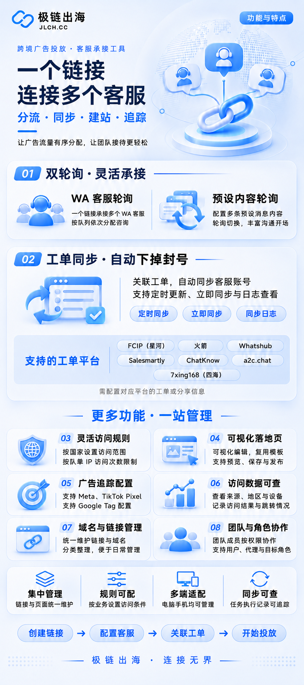
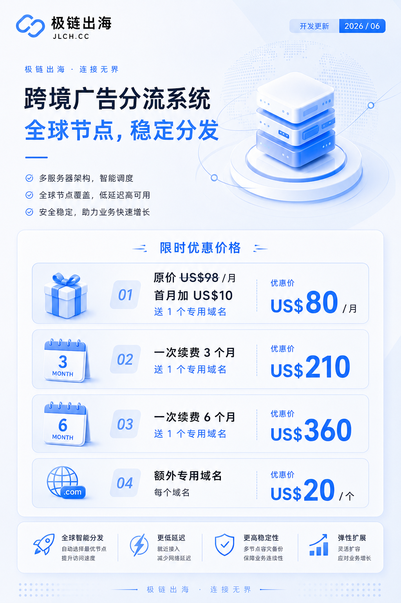
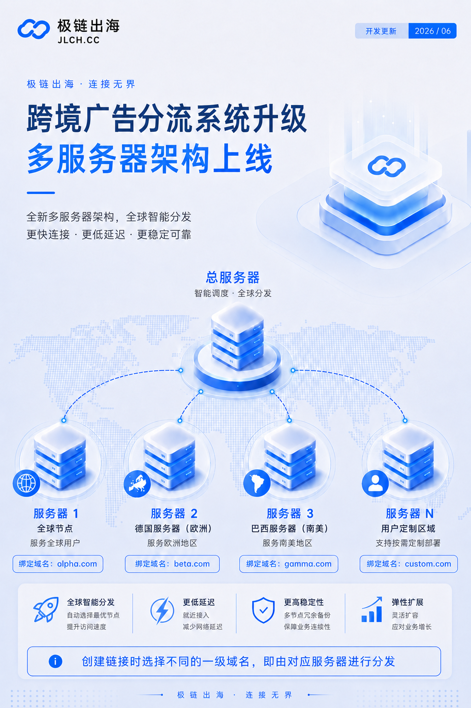

# 极链出海-原分流100

> 让每一次访问，都更快地抵达合适的内容与服务。

JLCH 是面向营销团队、客户服务团队与数字化运营团队的一站式链接管理平台。它将智能链接、落地页、访问分析、域名管理与团队协作集中到一个清晰易用的工作台中，帮助企业减少重复操作，更高效地承接和分析线上流量。

🌐 **官方网站：[https://fenliu100.com/](https://fenliu100.com/)**

## 为什么选择 JLCH

- **统一管理推广链接**：集中创建、分类和维护业务链接，降低多人协作时的管理成本。
- **灵活配置访问去向**：根据业务场景将访客引导至不同页面或服务入口。
- **快速制作落地页**：通过可视化方式编辑内容，适配活动推广、产品介绍和客户承接等场景。
- **清晰掌握访问表现**：查看访问趋势与链接表现，为后续运营调整提供依据。
- **支持团队协作**：通过成员与角色管理，让不同岗位各司其职。
- **兼顾电脑与移动端**：日常查看与管理不再受设备限制。

## 功能介绍

一个链接连接多个客服，集中管理客服轮询、工单同步、访问规则、落地页、广告追踪与团队协作。

## 核心能力

| 能力 | 带来的价值 |
| --- | --- |
| 智能链接 | 用更短、更易管理的入口承接不同渠道流量 |
| 链接分类 | 按项目、客户、活动或渠道整理链接 |
| 落地页管理 | 快速创建、编辑、预览和发布营销页面 |
| 服务入口管理 | 统一维护对外服务入口，减少人工替换 |
| 域名管理 | 集中查看和维护业务域名 |
| 访问记录与统计 | 了解访问时间、趋势和各链接表现 |
| 团队与权限 | 支持成员、角色和分工管理 |
| 多语言界面 | 方便不同地区的团队成员使用 |

## 适用场景

### 广告与内容投放

为不同广告、媒体和内容渠道建立独立链接，便于后续比较访问表现并持续优化投放策略。

### 社交媒体与私域运营

通过统一入口连接产品页、活动页或客户服务渠道，减少频繁更换外部推广素材的工作量。

### 活动与产品推广

快速搭建轻量落地页，集中展示卖点、活动信息与行动入口，缩短从创意到上线的时间。

### 多人团队协作

按职责分配成员权限，让运营、客服和管理人员在同一平台中协同工作。

## 使用流程

1. 创建项目或业务分类。
2. 添加需要推广的链接、页面或服务入口。
3. 配置域名与访问规则。
4. 将生成的链接投放到目标渠道。
5. 通过数据看板了解表现并持续调整。

## 产品特点

- 操作界面简洁，常用功能集中呈现
- 支持桌面端与移动端使用
- 功能模块可按业务需要组合
- 适合从个人运营到团队协作的不同规模
- 可根据实际业务提供部署与配置方案

## 更多资料

- [产品介绍](docs/product-overview.md)
- [宣传文案素材](docs/marketing-copy.md)
- [常见问题](docs/faq.md)
- [截图与素材说明](assets/README.md)

## 宣传海报

### 跨境广告分流系统

### 多服务器架构

## 了解与体验

如需产品演示、试用、部署方案或商务合作，请通过以下方式联系我们：

- 官方网站：[https://fenliu100.com/](https://fenliu100.com/)
- Telegram：[村长叔叔 @antong001](https://t.me/antong001)
- Telegram：[JLCH 官方 @jlchcc](https://t.me/jlchcc)

---

本文档用于产品能力介绍。具体功能、服务范围与交付方式，以实际版本及双方确认的方案为准。
